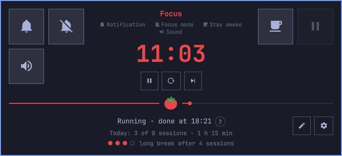
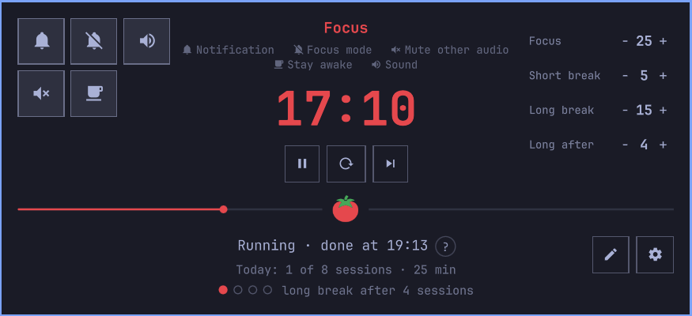
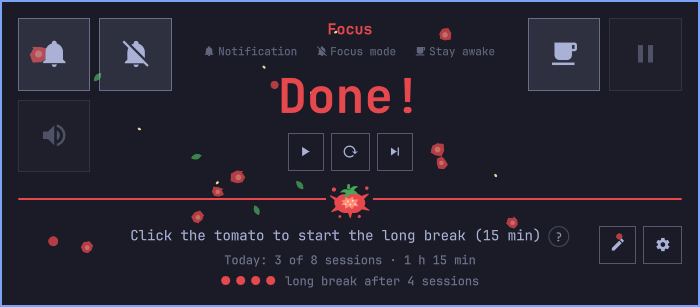
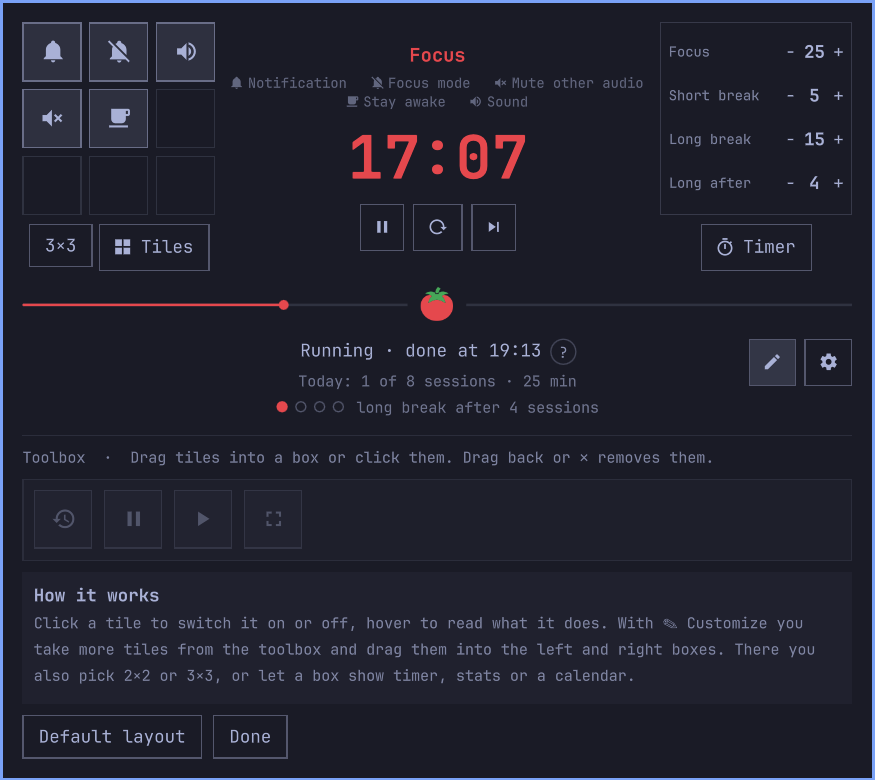
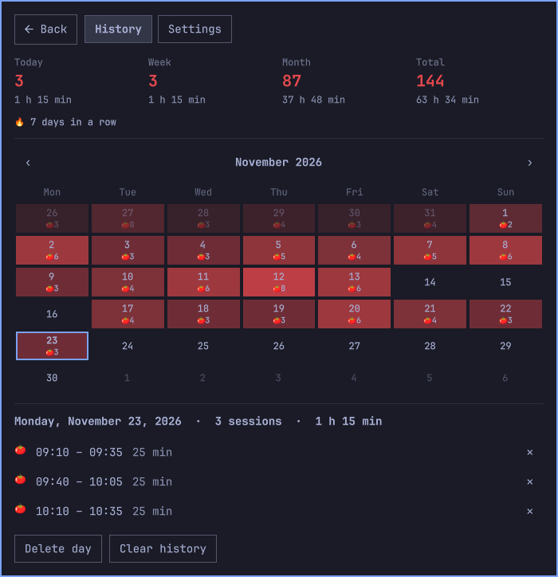
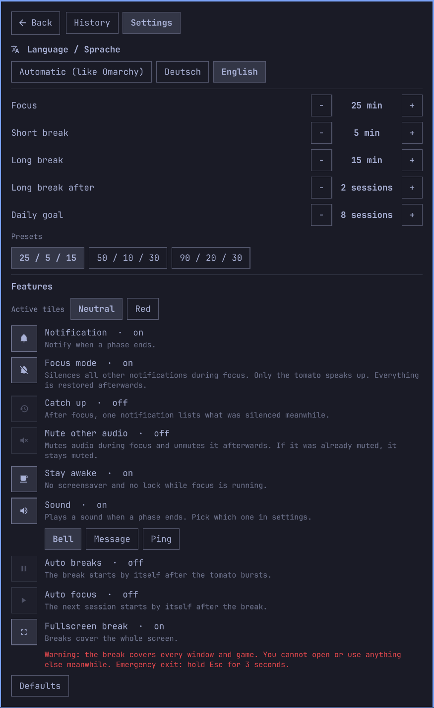

# 🍅 Tomato – focus timer for the Omarchy bar

A tomato in your bar. Click it, focus, take a break. Simple by default,
everything else is one click away when you want it.

- **Basic out of the box:** 25 min focus · 5 min short break · 15 min long break after 4 sessions · notification when a phase ends.
- **Every extra is off until you switch it on.** Nothing changes your system unless you ask for it.



## The tomato in the bar

| Tomato | Meaning |
|---|---|
| plain, in your bar colour | ready |
| red | focus running |
| green | break running |
| faded | paused |
| burst splat | session done – click to start the break |

**Mouse:** left click starts (or pins the card while running) · middle click pauses/resumes · right click opens the card · hover shows the card.

## The card



- **Centre:** phase, the features that are currently on, the big countdown with seconds, and play/pause · reset · skip.
- **The tomato sits on the progress beam.** When a focus session is done it bursts and tomato chunks, seeds and juice fly across the whole card.
- **Left and right boxes:** square tiles in a 2×2 or 3×3 grid – or timer durations, stats or a mini calendar.
- **Tiles:** each tile is a switch: faded = off, bright = on. Hover a tile and its explanation appears below the time. Nothing is ever cut off, long text wraps.
- **(?)** explains how the card works.
- **✎ Customize** · **⚙ History & settings**



## ✎ Customize




- Drag tiles from the toolbox into a box, move them between boxes (they swap), drag them back or press ✕ to remove them.
- **2×2 / 3×3** changes the grid of a box.
- **Box content** switches a box between **tiles**, **timer durations** (− / + for focus, breaks and rounds), **stats** (today, week, month, streak) and a **mini calendar**. Clicking stats or the calendar opens the full history.

## ⚙ History & settings



**History**
- Today · week · month · total, plus your streak (days in a row).
- Month calendar: the redder the day, the more sessions.
- Click a day to see every session with its times. A stopped session longer than one minute is listed as *stopped after …*.
- Delete a single entry, a whole day or everything. Every delete asks once more.

**Settings**
- Language: automatic (follows Omarchy), Deutsch or English.
- Active tiles: neutral (bright) or red.
- Focus, short break, long break, long break after N sessions, daily goal.
- Presets: 25/5/15 · 50/10/30 · 90/20/30.
- All features as tiles with their explanation.



## Features (all optional except the notification)

| Tile | What it does |
|---|---|
| 🔔 Notification | Notifies when a phase ends (on by default). |
| 🔕 Focus mode | Turns on Do Not Disturb during focus. Only if it was off, and only that is undone afterwards. The tomato's own notifications still get through. |
| 📬 Catch up | After focus, one notification lists what was silenced (needs focus mode). |
| 🔇 Mute other audio | Mutes the output that is the default when focus starts, and afterwards unmutes exactly that output (remembered by id and node name) – never another output, even if you switch outputs during focus. If it was already muted, it stays muted. |
| ☕ Stay awake | No screensaver or lock while focus runs (Wayland idle inhibitor). |
| 🔊 Sound | A sound when a phase ends. Three short freedesktop sounds (bell, message, ping), click to preview. |
| ⏸️ Auto breaks | The break starts by itself after the burst. |
| ▶️ Auto focus | The next session starts by itself after the break. |
| 🖥️ Fullscreen break | The break covers every screen. **Warning:** you cannot use anything else during the break. Emergency exit: hold Esc for 3 seconds. |

## Keyboard

```
omarchy-shell philippweidlich.tomato toggle   # start / pause / resume
omarchy-shell philippweidlich.tomato skip
omarchy-shell philippweidlich.tomato reset
omarchy-shell philippweidlich.tomato open            # card on the focused monitor
omarchy-shell philippweidlich.tomato open history    # also: customize, settings
omarchy-shell philippweidlich.tomato close
```

Bind them in `~/.config/hypr/bindings.lua` like any other command.

## Data and privacy

Everything stays on your machine in `~/.local/state/tomato/`
(`state.json`, `settings.json`, `history.json`). No network access.

The plugin only runs fixed commands, never anything built from text it
reads, and only for features you switched on:

| Command | When |
|---|---|
| `omarchy-notification-send` | notification at the end of a phase |
| `omarchy-shell notifications isDnd` / `setDnd on\|off` | focus mode |
| `omarchy-shell -q omarchy.indicators refresh` | after focus mode changes |
| `pw-play /usr/share/sounds/freedesktop/stereo/<sound>.oga` | sound |
| `bash -c` with a fixed `wpctl inspect` / `get-volume` / `set-mute` script | mute other audio (only the exact output it muted is unmuted) |

*Catch up* reads `~/.local/state/omarchy/notifications/history.json`
(read only) to list what was silenced during focus. All text from it is shown
as plain text.

Like every Omarchy plugin it runs unsandboxed inside the shell.

## Install / remove

```
omarchy plugin add https://github.com/PhilippWeidlich/omarchy-tomato --enable
omarchy plugin remove philippweidlich.tomato
```

Languages: English and German, switchable in the settings.
"Automatic" follows the Omarchy language and falls back to English.

Tested on Omarchy with Hyprland, one and two monitors.

## License

MIT
